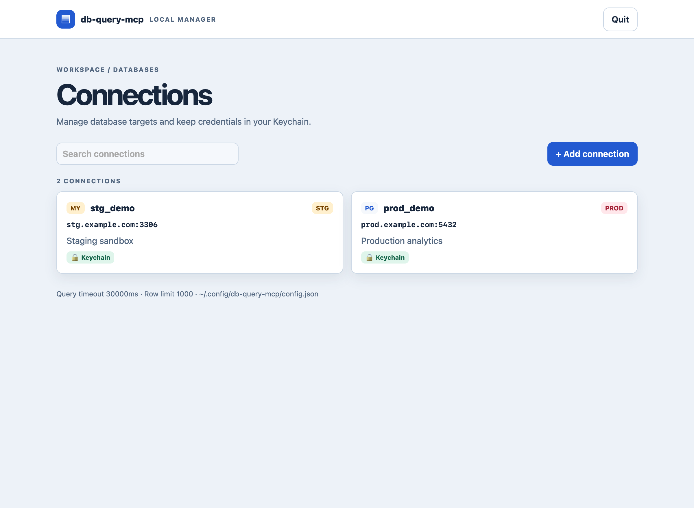

# db-query-mcp

A [Model Context Protocol (MCP)](https://modelcontextprotocol.io/) server for running read-only SQL across MySQL and PostgreSQL. Keep database passwords in macOS Keychain and manage connections from a local browser UI or the CLI.

## Features

- Mix MySQL and PostgreSQL connections; expose several databases per connection.
- Store passwords in Keychain instead of the JSON config. Passwords are write-only in the UI.
- Search, edit, rename, and test connections locally. Tag targets as development, staging, or production.
- Run parameterized read-only queries with automatic row limits and query timeouts. Use dedicated read-only database accounts: the SQL guard is not a substitute for database permissions.

## Requirements and installation

[Bun](https://bun.sh/) **1.4 or later**. macOS is supported; other platforms are best-effort and untested.

db-query-mcp runs from a source checkout. It does not need to be published to a registry, and no build step is required.

```sh
git clone https://github.com/andychinghk01/db-query-mcp.git
cd db-query-mcp
bun install
bun run ui                     # open the manager in your browser
```

With no arguments, `bun src/index.ts` starts the MCP stdio server.

### Run from a checkout

Every command works from the checkout directory:

```sh
bun run ui                     # same as: bun src/index.ts ui
bun src/index.ts migrate --dry-run
bun src/index.ts set-password <name>
bun src/index.ts doctor
```

To run the commands from any directory, use an alias (replace the path with your checkout):

```sh
alias dqm='bun /absolute/path/to/db-query-mcp/src/index.ts'
dqm ui
dqm doctor
```

Alternatively, `bun link` in the checkout registers the package locally, and `bun link db-query-mcp` in another project makes the `db-query-mcp` bin available there.

The sections below write commands as `db-query-mcp <command>`; substitute `bun run ui`, the `dqm` alias, or `bun src/index.ts <command>` for your setup. The package is also usable through `bunx` or `bun add -g` once it is published to a registry.

## Manage connections

Run `bun run ui` from the checkout (see [Run from a checkout](#run-from-a-checkout)). It starts a server on `127.0.0.1` and opens your default browser at `http://127.0.0.1:<port>/#t=<token>`. Add a connection, enter its database credentials, add the databases to expose, and save. Use **Test connection** to run `SELECT 1`. To change an existing password, select **Replace**, enter the new value, and save. The current password is never shown. Production cards carry a red **PROD** badge, and deleting one requires typing its name.

Launch options:

| Command | Effect |
| --- | --- |
| `bun run ui` | Random free port; opens the default browser |
| `bun run ui -- --no-open` | Prints the URL to stderr and does not open a browser; paste it into a browser yourself |
| `bun run ui -- --port 4321` | Fixed port (1 to 65535) |

The `--` after `bun run ui` is required so the flags reach the command. Only one UI instance can run at a time; a second launch is refused. A UI session reads and writes your real config (`~/.config/db-query-mcp/config.json`) and Keychain service. To try it without touching them, point it at scratch values and delete the entries afterwards:

```sh
DB_QUERY_MCP_CONFIG=/tmp/try/config.json DB_QUERY_MCP_KEYCHAIN_SERVICE=dqm-try bun run ui
```

The first Keychain access may show a macOS prompt for the Bun binary; choose **Always Allow**.

The UI runs only on `127.0.0.1`; keep its launch URL private. The browser removes the session token from the URL after loading it. Use **Quit** to stop the server, or let it stop after 15 minutes without authenticated API activity. If the config changes elsewhere, use **Reload** before saving again. Shortcuts: `N` adds a connection, `/` focuses search, `Cmd+S` saves, and `Esc` closes the editor.



| View | Light | Dark |
| --- | --- | --- |
| Connections | [List](docs/screenshots/list-light.png) | [List](docs/screenshots/list-dark.png) |
| Connection editor | [Staging](docs/screenshots/editor-light.png) | [Staging](docs/screenshots/editor-dark.png) |
| Production editor | [Production](docs/screenshots/prod-editor-light.png) | [Production](docs/screenshots/prod-editor-dark.png) |

## Keychain and migration

Each connection name is a Keychain item under the service `db-query-mcp` by default. The MCP server fetches the password when needed; it does not cache it. In 1.1.x, a legacy config `password` still takes precedence and triggers a one-time stderr warning. Version 2.0.0 will reject plaintext passwords.

**What Keychain protects:** moving passwords out of JSON reduces plaintext exposure through backups, grep, and readable files such as a mode `0644` config. It does not protect against another Bun script run as your user: the Keychain ACL trusts the Bun binary and its code-signing hash (cdhash), not this application. After `brew upgrade bun`, run `db-query-mcp doctor` in a terminal so you can respond to any Keychain prompt. A locked Keychain or unanswered prompt can produce a `KeychainTimeout` after 15 seconds instead of hanging the MCP client.

**Write lock:** UI changes, `migrate`, `set-password`, and rollback writes take an exclusive `<config>.write.lock` containing the holder PID. A lock left by a dead process is reclaimed automatically, and a lock with no PID older than five seconds is reclaimed. If another process holds it for about two seconds, the command fails with `Another db-query-mcp process is writing the config. Try again.` Editors and tools that do not honor this lock can still race with the UI; the UI ETag check and conflict banner, together with rollback ETag checks, reject stale writes, so close the UI before hand-editing the file.

**Partial failures:** When a Keychain write or delete fails midway, db-query-mcp restores the config bytes and previous secret values while reporting the original error. After a Keychain timeout of 15 seconds, the underlying call cannot be cancelled and the real secret state is **UNKNOWN**; run `db-query-mcp doctor`, then `db-query-mcp set-password <name>` for any connection it reports as missing.


### Upgrade from plaintext

```sh
db-query-mcp migrate --dry-run  # lists connection names only; changes nothing
db-query-mcp migrate            # writes and verifies Keychain items before editing JSON
db-query-mcp doctor             # confirm access and check remaining plaintext/missing entries
```

The UI's **Move passwords to Keychain** banner does the same migration. Migration creates no plaintext backup and is safe to rerun. It does not remove copies already in backups or version history. To roll back for an older setup, run `db-query-mcp migrate --revert`. This puts passwords back in the mode `0600` JSON file and leaves the Keychain items in place. Migrate again when the older setup is no longer needed.

## CLI reference

| Command | Behavior |
| --- | --- |
| `db-query-mcp` | Start MCP over stdio. |
| `db-query-mcp ui [--port N] [--no-open]` | Start the loopback manager on an assigned port or the requested port. `--no-open` prints the URL to stderr without launching a browser. |
| `db-query-mcp migrate [--dry-run] [--revert]` | Move plaintext passwords to Keychain by default. Preview with `--dry-run`; restore plaintext with `--revert`. |
| `db-query-mcp set-password <name> [--stdin]` | Replace the named connection's password via a hidden terminal prompt. Use `--stdin` explicitly to pipe a password; do not put it in command arguments. |
| `db-query-mcp doctor` | Report the Bun binary, a Keychain round trip, password presence, plaintext entries, and config permissions. |
| `db-query-mcp --help` | Show CLI usage. |

Exit codes: `0` success, `1` operation or diagnostic failure, `2` invalid usage.

## Configuration

`DB_QUERY_MCP_CONFIG` overrides the JSON path; the default is `~/.config/db-query-mcp/config.json`. `DB_QUERY_MCP_KEYCHAIN_SERVICE` overrides the service name; use the same service for the CLI, UI, and MCP server. The UI can create the config on first save. If you edit it manually, set mode `0600` and use `set-password` for each connection. Connection names outside `[A-Za-z0-9_.-]{1,64}` keep working for queries but cannot be edited in the UI; rename them in the config file.

```json
{
  "connections": [
    {
      "name": "stg_demo",
      "description": "Read-only staging sandbox",
      "type": "postgresql",
      "host": "stg.example.com",
      "port": 5432,
      "username": "readonly",
      "environment": "stg",
      "databases": [{ "name": "demo", "description": "Example data" }]
    }
  ]
}
```

| Field | Required | Meaning |
| --- | --- | --- |
| `connections` | Yes | Array of configured connections. |
| `queryTimeoutMs` | No | Query timeout in milliseconds; default `30000`. |
| `defaultRowLimit` | No | Maximum rows returned; default `1000`. |
| `connections[].name` | Yes | Unique connection ID and Keychain item name. The UI allows 1–64 ASCII letters, digits, underscores, dots, or hyphens. |
| `connections[].description` | Yes | Human-readable connection description. |
| `connections[].type` | No | `mysql` (default) or `postgresql`. |
| `connections[].host`, `.port` | Yes | Database hostname and integer port (`1`–`65535` in the UI). |
| `connections[].username` | Yes | Dedicated read-only database user. |
| `connections[].password` | No | Deprecated. Plaintext accepted with a warning in 1.1.x; rejected in 2.0.0. Omit to use Keychain. |
| `connections[].environment` | No | `dev`, `stg`, or `prod`; a label, not a permissions setting. |
| `connections[].databases` | Yes | Non-empty array of objects with `name` (database name) and `description` (shown in `list_db`). |

## MCP client configuration

The launch configuration is unchanged. For clients using `mcpServers` (such as Claude Desktop or Claude Code), point `bun` at the checkout's entry file:

```json
{
  "mcpServers": {
    "db-query-mcp": {
      "command": "bun",
      "args": ["/absolute/path/to/db-query-mcp/src/index.ts"]
    }
  }
}
```

For a custom config path, add `"env": { "DB_QUERY_MCP_CONFIG": "/custom/path/config.json" }` to the server entry. Once the package is published to a registry, `"command": "bunx", "args": ["db-query-mcp"]` works too.

### Tools

- **`list_db`** takes no arguments. Each row includes `name`, `description`, `connectionName`, `type`, `host`, `port`, and `environment` (`dev`, `stg`, `prod`, or `null` when unset).
- **`query`** takes `dbName` and `sql`, plus optional `params` and `connectionName`. If the same database name exists on multiple connections, supply `connectionName` to choose the target. Use `?` placeholders on MySQL and `$1`, `$2`, … on PostgreSQL.

The query guard permits `SELECT`, `SHOW`, `DESCRIBE`, `DESC`, and `EXPLAIN`. `SELECT` queries get a SQL-side row limit when supported by the wrapper; other statements are sent as written and their returned rows are capped by the server.

## Development

```sh
bun install
bun run typecheck
bun test                # unit, CLI, HTTP API, and MCP stdio tests
bun run test:e2e        # separate macOS WebKit suite using Bun.WebView
bun run screenshots     # regenerate all six README images with fake data
```

The screenshot script sets a `data-theme` override to capture both palettes reliably in headless WebKit. Normal UI sessions follow the system color scheme.

## License

MIT © Andy Ching
